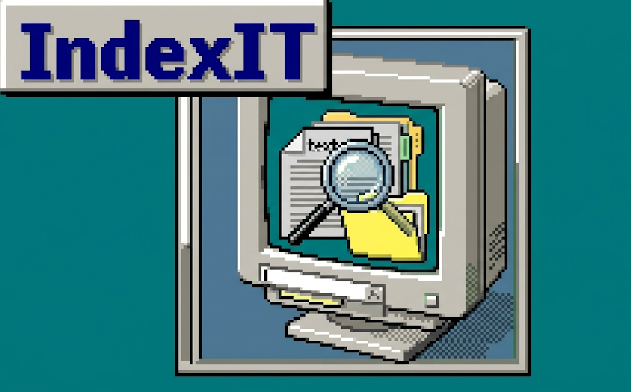
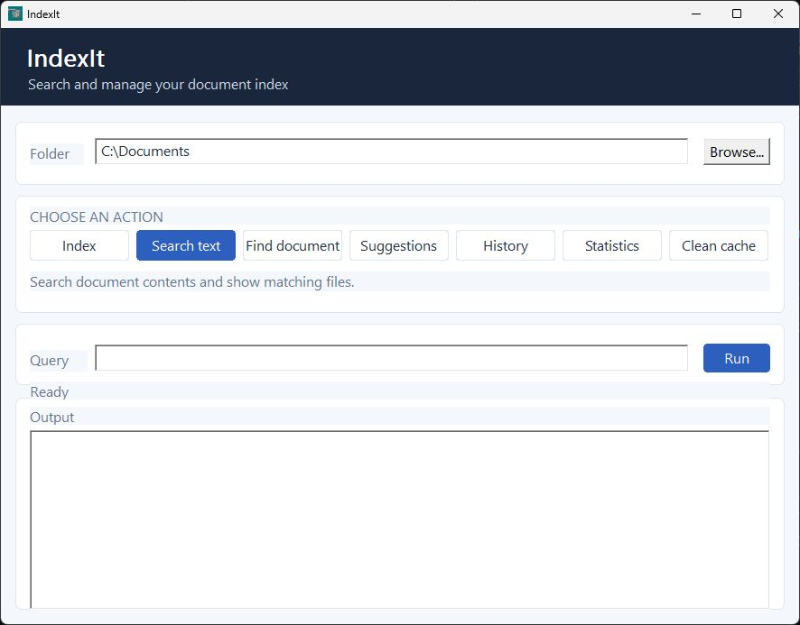

<p align="center">
  
</p>

<h1 align="center">IndexIt</h1>

<p align="center"><strong>Find the document by what it says, not just what you named it.</strong></p>

<p align="center">
  
</p>

<p align="center">A small Windows desktop search app, with a C and C++ indexing engine underneath.</p>

## Find it your way

Pick a folder, index it, and search its documents from one window. Search inside
files when you remember a phrase, or search filenames when you remember what
you called the document. Suggestions update as you type.

The desktop app also lets you browse search history and index statistics, and
manage the local cache. Hover over an action for a short explanation.

## Get started

IndexIt builds on Windows with CMake and a C/C++ compiler that includes a
Windows resource compiler.

```powershell
cmake -S . -B build
cmake --build build --config Release
```

Launch the desktop app:

```powershell
.\build\IndexItWindow.exe
```

Choose a folder and select **Index** first. Then use **Search text** or **Find
document**. With a Visual Studio CMake generator, the executable is typically
at `build\Release\IndexItWindow.exe`.

## Search from the terminal

The CLI is built next to the desktop app. Run `--help` to see all commands and
filters:

```powershell
.\build\indexit.exe --help
```

```powershell
# Index or update a folder
.\build\indexit.exe index "C:\Users\You\Documents"

# Search the contents of indexed files
.\build\indexit.exe search "C:\Users\You\Documents" "project schedule"

# Find indexed files by name
.\build\indexit.exe find "C:\Users\You\Documents" "meeting notes"

# Restrict a content search by extension
.\build\indexit.exe search "C:\Users\You\Documents" "invoice" --ext .pdf
```

Other commands include `suggest`, `history`, `stats`, `clean`, and the terminal
interface `ui`.

## What it can read

| Documents | Extraction |
| --- | --- |
| `.txt`, `.csv`, `.log`, `.md`, `.json`, `.xml` | Plain text, including UTF-8 and BOM-marked UTF-16. |
| `.c`, `.cpp`, `.h` | Source code as text. |
| `.html`, `.htm`, `.rtf` | Text with basic markup or formatting removal. |
| `.eml` | Raw email text, including headers. |
| `.docx`, `.pptx`, `.xlsx`, `.odt` | Text from document XML parts. Legacy `.doc`, `.ppt`, and `.xls` files are not supported. |
| `.zip` | Text from contained `.txt`, `.md`, `.csv`, and `.log` files. |
| `.pdf` | Best-effort extraction from some plain or Flate-compressed text streams. |

PDF extraction is limited. Scanned pages need OCR, which IndexIt does not
provide; encrypted PDFs and some compressed or font-encoded content may not be
searchable.

## Under the hood

The desktop window starts the CLI in the background and displays its results.
The C and C++ core handles file discovery, extraction, tokenization, indexing,
and search. Each selected folder gets its own index cache so results stay with
the folder they came from.

The optional C++ add-on library is separate from the app and has its own build
instructions in [`addons/README.md`](addons/README.md).

## Build and run the checks

```powershell
ctest --test-dir build --output-on-failure
```

## Project map

```text
src/          Core engine, command-line app, and Windows desktop UI
include/      Public headers
addons/       Optional standalone C++ library
tests/        Core test runner and document fixtures
third_party/  Miniz and SQLite source
assets/       App icon and screenshot
docs/         Architecture and project notes
```
